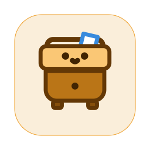
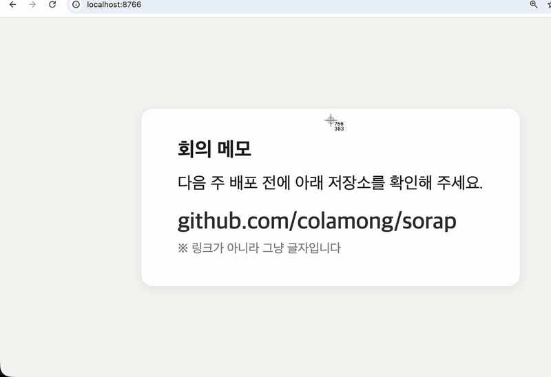
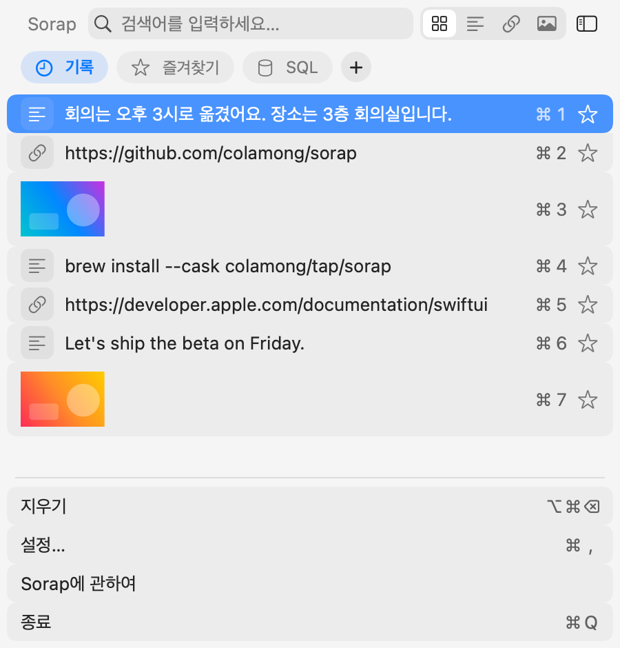
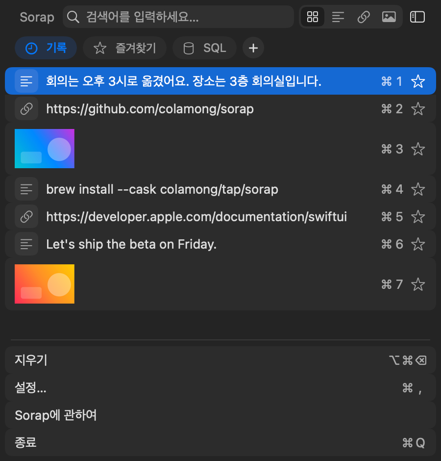
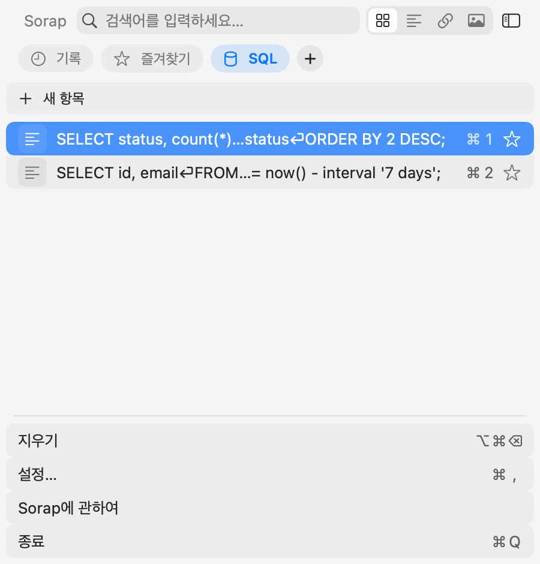
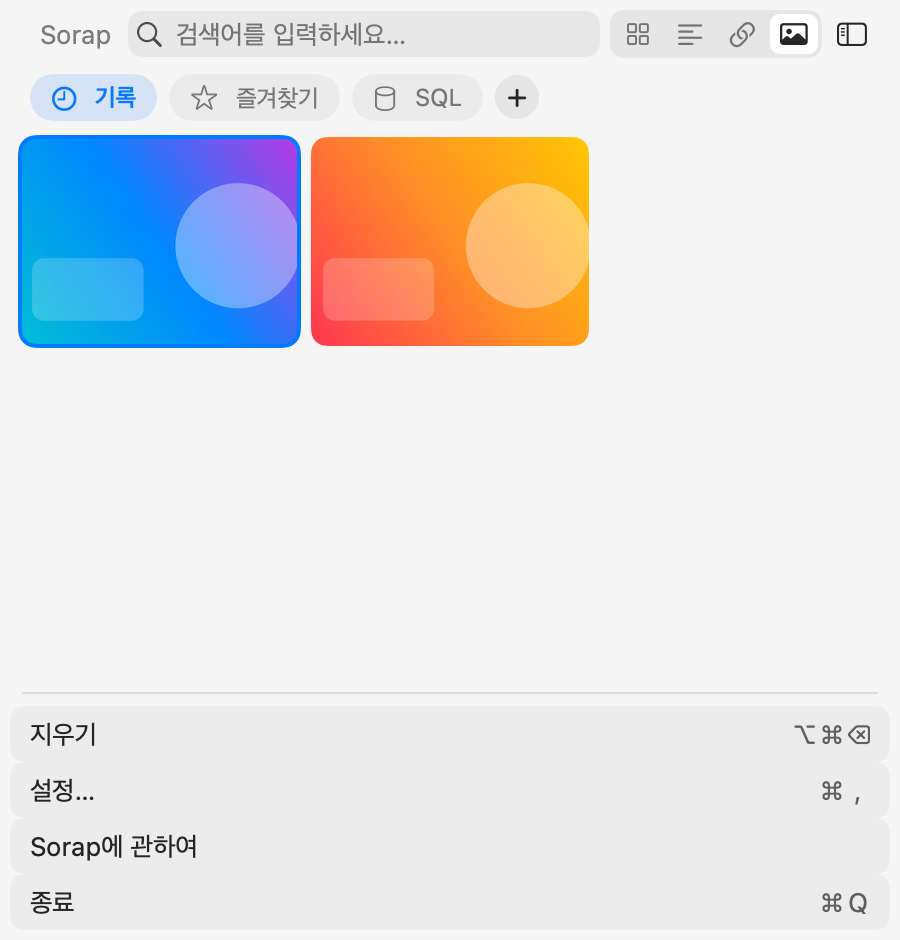

# Sorap

복사한 것을 보드에 나눠 담아 두는 macOS 메뉴바 클립보드 앱입니다.
한국어 Mac에서는 이름이 **서랍**으로 보입니다.

macOS 14 이상에서 동작합니다. 무료이고 소스가 공개돼 있습니다.

[English](#english)



클릭할 수 없는 링크도 캡쳐 한 번이면 열립니다. → [캡쳐 글자 바로 쓰기](#기능)

## 스크린샷

<p>
  
  
</p>
<p>
  
  
</p>

## 기능

- **보드** — 자주 쓰는 항목을 보드에 나눠 둡니다. 맨 앞의 `기록`은 복사한 내용이 쌓이는 기본 보기이고, 그다음에 고정된 `즐겨찾기` 보드가 오며, 보드는 얼마든지 더 만들 수 있습니다. 이름을 비워 두면 "새 보드"가 됩니다.
- **별표** — 항목의 별을 누르면 `즐겨찾기`로 들어갑니다.
- **우클릭 메뉴** — 이름 붙이기, 다른 보드로 옮기기, 경로 복사(복사한 파일), 이미지 저장, 링크 열기·Finder에서 보기·글자 복사(이미지 속 글자), 삭제. 보드 칩을 우클릭하면 `보드 비우기`가 있고, 항상 확인을 거칩니다.
- **지우기** — 아래쪽 버튼(`⌥⌘⌫`)은 지금 보고 있는 화면에 따라 달라집니다. `기록`에서는 `기록 모두 지우기…`이고, 보드에 담지 않은 항목만 지웁니다. 지우기 전에 확인을 묻고, `다시 묻지 않기`를 고르면 이후에는 묻지 않습니다(설정에서 다시 켤 수 있음). 보드 화면에서는 `“<이름>” 비우기…`로 바뀌어 그 보드를 비웁니다. 이때는 항상 확인을 묻고 항목 수를 보여 줍니다. 항목 하나는 우클릭 → `삭제` 또는 `⌥⌫`로 지웁니다.
- **스니펫** — 보드 안의 "+ 새 항목"으로 글을 직접 써 둘 수 있습니다.
- **종류 필터** — 전체·텍스트·링크·파일·이미지 중에서 고릅니다. 이미지는 선명한 썸네일 격자로 보이고, Finder에서 복사한 이미지 파일은 파일 아이콘으로 보입니다. 이미지가 아닌 파일과, Finder의 `⌥⌘C`로 복사한 파일 하나의 경로는 파일로 분류됩니다.
- **경로 복사** — 복사한 파일을 우클릭하고 `경로 복사`를 누르면 경로가 텍스트로 복사됩니다. 파일이 여러 개면 한 줄에 하나씩 담깁니다.
- **Markdown으로 복사** — 웹 페이지나 문서에서 복사한 서식 있는 글을 우클릭 → `Markdown으로 복사`로 바꿔 담습니다. 문단·목록·굵게·기울임·코드·링크를 옮깁니다.
- **이미지 저장** — 우클릭 메뉴로 저장하거나, 격자의 썸네일을 Finder로 끌어다 놓습니다.
- **캡쳐 글자 바로 쓰기** — 화면을 클립보드로 캡쳐하면(`⌃⇧⌘4`) 이미지 속 글자를 읽어 팝업으로 묻습니다. 링크면 `링크 열기`, 실제로 있는 파일 경로면 `Finder에서 보기`, 그 밖의 글자면 `글자 복사`를 고를 수 있습니다. QR 코드가 찍혀 있으면 주변 글자보다 QR 내용을 먼저 씁니다. `다시 묻지 않기`를 고르면 그 종류는 이후 묻지 않고 바로 실행합니다. 설정 → 일반 → `캡쳐 이미지`에서 팝업을 끄거나, 링크·경로의 기본 동작(열기/복사)을 바꾸거나, `다시 묻지 않기`를 초기화합니다. 기록에 있던 이미지는 우클릭 메뉴에서 같은 동작을 고릅니다.
- **자동 정리** — 설정 → 저장 → `보관 기간`에서 7일·30일·90일을 고르면, 그보다 오래 복사하지 않은 기록을 지웁니다. 고정한 항목과 보드 항목은 지우지 않습니다. 기본값은 `계속`(지우지 않음)입니다.
- **검색** — 이름을 붙인 항목도 원래 내용으로 찾을 수 있습니다.
- **로컬 저장** — 모든 데이터는 이 Mac에만 저장됩니다.

## 단축키

| 키 | 동작 |
|---|---|
| `⇧⌘C` | Sorap 열기 (설정에서 바꿀 수 있음) |
| `⌘1`–`⌘9` | 해당 번호의 항목 붙여넣기 |
| `⌥P` | 즐겨찾기에 넣기·빼기 (설정에서 바꿀 수 있음) |
| `⌥⌫` | 항목 삭제 (설정에서 바꿀 수 있음) |
| `⌥⌘⌫` | 기록에서는 `기록 모두 지우기…` (보드 항목은 지우지 않음), 보드에서는 `“<이름>” 비우기…` |
| `⌘Y` | 미리보기 (설정에서 바꿀 수 있음) |
| `Tab` | 다음 보드 |
| `⌥←` / `⌥→` | 이전 보드 / 다음 보드 |
| `⇧Tab` 또는 `⌘T` | 다음 종류 필터 |
| `⇧⌘T` | 이전 종류 필터 |
| `←` `→` / `↑` `↓` | 이미지 격자에서 한 칸 / 한 줄 이동 |
| `⌘,` | 설정 |

## 설치

### Homebrew (권장)

```sh
brew install --cask colamong/tap/sorap
```

Homebrew로 설치하면 바로 열립니다. Sorap은 Apple 공증을 받지 않은 앱이라, 설치 과정에서 macOS의 "인터넷에서 받은 파일" 표시를 지워 첫 실행 경고가 뜨지 않게 합니다.

### 직접 내려받기

[GitHub 릴리스](https://github.com/colamong/sorap/releases)에서 최신 zip을 받아 압축을 풀고, `Sorap.app`을 `응용 프로그램` 폴더로 옮깁니다.

이 방법으로 받으면 처음 열 때 "'서랍'을(를) 열지 않음" 창이 뜹니다. **휴지통으로 이동**을 누르면 앱이 지워지니 주의하세요.

1. 경고 창에서 **완료**를 누릅니다.
2. **시스템 설정 → 개인정보 보호 및 보안**을 엽니다.
3. 아래쪽 보안 항목에서 '서랍' 옆의 **그래도 열기**를 누릅니다.

한 번 열고 나면 다음부터는 경고가 뜨지 않습니다.

### 메뉴 막대 아이콘이 안 보이면

macOS 26부터는 메뉴 막대 아이콘을 앱마다 허용합니다. **시스템 설정 → 메뉴 막대 → 메뉴 막대에서 허용**에서 **서랍**을 켜세요. 아이콘이 보이지 않아도 `⇧⌘C`로 열 수 있습니다.

### 접근성 권한

고른 항목을 쓰던 앱에 바로 붙여넣으려면 Sorap이 `⌘V` 입력을 대신 보내야 합니다.
여기에 접근성 권한이 필요합니다. **시스템 설정 → 개인정보 보호 및 보안 → 손쉬운 사용**에서 Sorap을 켜 주세요.
권한이 없어도 복사는 됩니다.

## 언어

한국어, English, 日本語, 简体中文, 繁體中文, Español을 지원합니다.
Mac의 언어와 상관없이 설정에서 앱 언어를 따로 고를 수 있습니다. 바꾼 언어는 앱을 다시 시작하면 적용되고, 설정에서 `지금 다시 시작`을 누르면 바로 다시 시작합니다.

## 데이터

복사한 내용은 이 Mac에만 저장됩니다. 저장 위치는 아래 폴더입니다.

```
~/Library/Containers/io.github.colamong.sorap
```

## 빌드

Xcode 26 이상이 필요합니다. `Maccy.xcodeproj`를 열고 `Maccy` 스킴을 실행합니다.
Xcode 타깃 이름은 Maccy에서 물려받은 그대로입니다. 만들어지는 앱은 `Sorap.app`입니다.

단위 테스트는 터미널에서 돌립니다.

```sh
scripts/test.sh
```

## 감사의 말

Sorap은 Alex Rodionov의 [Maccy](https://github.com/p0deje/Maccy)를 포크해 만들었습니다.
클립보드를 지켜보고, 저장하고, 붙여넣는 부분은 Maccy의 코드입니다.
좋은 앱을 MIT 라이선스로 공개해 준 Maccy와 기여자들에게 감사드립니다.

## 라이선스

[MIT](LICENSE). Maccy의 저작권 표시와 Sorap의 저작권 표시가 함께 들어 있습니다.

---

## English

Sorap is a macOS menu-bar clipboard manager that keeps your copies in boards.


A link you can't click opens with one screenshot. → [Act on captured text](#features)
On a Korean Mac it shows up as **서랍** ("drawer"). It runs on macOS 14 or later and is free and open source.

### Features

- **Boards** — The first chip is the built-in History view, followed by the fixed Favorites board; add as many boards as you like. A board left unnamed is called "New board".
- **Star** an item to move it into Favorites.
- **Right-click** an item to name it, move it to another board, copy a file's path, save an image, open a link or path read from an image, copy an image's text, or delete it. Right-click a board chip for **Empty Board**, which always asks first.
- **Clearing** — the bottom button (`⌥⌘⌫`) follows the view you are in. In **History** it is **Clear History…** and removes only items not saved in a board. It asks for confirmation first; choose "don't ask again" to skip it, and turn it back on in Settings. In a board it becomes **Empty “&lt;name&gt;”…** and empties that board. That always asks first and shows the item count. To delete a single item, right-click → **Delete** or press `⌥⌫`.
- **Snippets** — write your own items with "+ New item" inside a board.
- **Kind filter** — All, Text, Links, Files, or Images. Images show as a sharp thumbnail grid, and image files copied from Finder show their file icon. Non-image files, and a single path copied with Finder's `⌥⌘C`, are classified under Files.
- **Copy Path** — right-click a copied file and choose **Copy Path** to put its path on the clipboard as text. Several files are copied one per line.
- **Copy as Markdown** — right-click rich text copied from a web page or document and choose **Copy as Markdown**. Paragraphs, lists, bold, italic, code and links carry over.
- **Save images** from the context menu, or drag a grid tile to Finder.
- **Act on captured text** — take a screenshot to the clipboard (`⌃⇧⌘4`) and Sorap reads its text and asks what to do: **Open Link** for a link, **Show in Finder** for a path that exists, **Copy Text** for anything else. A QR code in the capture wins over the text around it. Choose "Don't ask again" to run that kind's action without asking from then on. Settings → General → **Captures** turns the prompt off, picks open or copy as the default for links and paths, and resets "Don't ask again". Older images offer the same actions in the context menu.
- **Auto cleanup** — pick 7, 30 or 90 days in Settings → Storage → **Keep history** to remove items not copied within that time. Pinned items and board items are never removed. The default is **Forever**.
- **Search** also matches the original content of renamed items.
- Everything is stored locally on your Mac.

### Shortcuts

| Key | Action |
|---|---|
| `⇧⌘C` | Open Sorap (configurable) |
| `⌘1`–`⌘9` | Paste the item with that number |
| `⌥P` | Add to / remove from Favorites (configurable) |
| `⌥⌫` | Delete item (configurable) |
| `⌥⌘⌫` | **Clear History…** in History (board items are kept); **Empty “&lt;name&gt;”…** in a board |
| `⌘Y` | Preview (configurable) |
| `Tab` | Next board |
| `⌥←` / `⌥→` | Previous / next board |
| `⇧Tab` or `⌘T` | Next kind filter |
| `⇧⌘T` | Previous kind filter |
| `←` `→` / `↑` `↓` | Move one tile / one row in the image grid |
| `⌘,` | Settings |

### Install

```sh
brew install --cask colamong/tap/sorap
```

Homebrew is recommended: Sorap is not notarized, and the cask clears macOS's download quarantine flag after install so the app opens without a Gatekeeper warning.

Or download the latest zip from [GitHub Releases](https://github.com/colamong/sorap/releases) and move `Sorap.app` to Applications.
On first launch macOS says it can't verify the app — click **Done** (not **Move to Trash**, which deletes it), then open **System Settings → Privacy & Security** and click **Open Anyway** next to Sorap.

If the menu bar icon doesn't appear (macOS 26 and later), turn Sorap on in **System Settings → Menu Bar → Allow in the Menu Bar**. `⇧⌘C` opens Sorap either way.

To paste straight into the app you were using, Sorap sends `⌘V` for you. That needs Accessibility permission
(**System Settings → Privacy & Security → Accessibility**). Copying works without it.

### Languages

Korean, English, Japanese, Simplified Chinese, Traditional Chinese, and Spanish.
You can pick the app language in Settings, independent of the system language. A new language applies after a restart; Sorap offers **Restart now**.

### Data

Your clipboard history stays on your Mac, in `~/Library/Containers/io.github.colamong.sorap`.

### Build

Requires Xcode 26 or later. Open `Maccy.xcodeproj` and run the `Maccy` scheme. The target keeps Maccy's name; the product is `Sorap.app`.
Run the unit tests with `scripts/test.sh`.

### Thanks to Maccy

Sorap is a fork of [Maccy](https://github.com/p0deje/Maccy) by Alex Rodionov.
The clipboard monitoring, storage, and paste engine is Maccy's. Thank you to Maccy and its contributors for releasing it under the MIT license.

### License

[MIT](LICENSE), with both Maccy's and Sorap's copyright notices.
